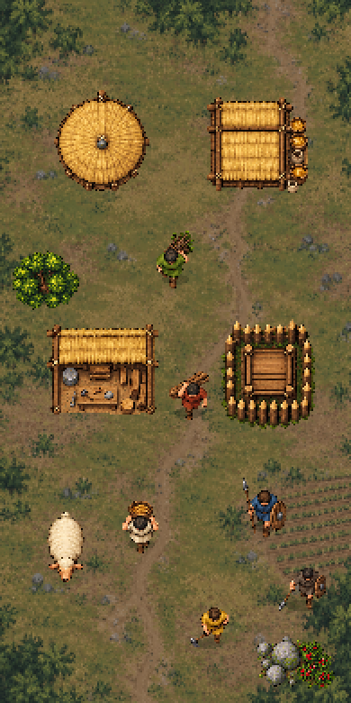
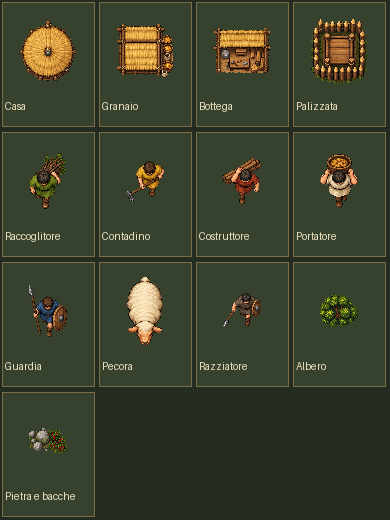

# Campione grafico per Simone

**PROVVISORIO, da approvare da Simone.** Questa è una prova visiva: nessuna immagine di questa cartella è collegata al gioco o al service worker. La BUILD 172 resta quella della partita di test.

## La scena sul telefono

Dimensione **390×780 px**, presentata in pixel netti. I cinque mestieri sono raccoglitore, contadino, costruttore, portatore e guardia. La figura scura con lancia in basso a destra è un razziatore; non rappresenta una popolazione storica specifica.

## Ritagli e controllo dello stile

Le tavole generate sono [`sorgente-oggetti.png`](sorgente-oggetti.png) e [`sorgente-terreno.png`](sorgente-terreno.png). Lo script [`compone.py`](compone.py) isola con una maschera alpha i **13 oggetti** dalla prima tavola, taglia ogni silhouette e costruisce la scena sopra la seconda. I PNG in [`ritagli/`](ritagli/) hanno sfondo trasparente vero; [`verifica.py`](verifica.py) controlla alpha, bordi e dimensioni. Esito: **13/13 ritagli validi**, scena 390×780; nessun file runtime fa riferimento al campione. Il foglio sorgente non è già pronto per l’uso in gioco: la sfumatura residua fra gli oggetti è stata esclusa dalla maschera dei ritagli.

## Direzione storica e artistica

Proposta: vista **ortogonale dall’alto**, corpi piccoli con proporzioni umane, contorno caldo, superfici in due o tre toni, tavolozza di erba oliva, argilla, paglia e legno. Strutture rurali semplici in terra, intreccio vegetale, legno e paglia; abiti senza stemmi, corazzature romane o segni etnici immaginari. È un linguaggio visivo da verificare, **non** una ricostruzione puntuale di Umbri, Sanniti o Irpini.

La cautela si basa su dati archeologici di contesto: un abitato con capanne dell’età del Ferro a [Camerino, Soprintendenza](https://sabapascoli.cultura.gov.it/camerino-durante-i-lavori-di-scavo-della-pedemontana-ritrovato-un-abitato-delleta-del-ferro-costituito-da-capanne-databili-al-vii-vi-secolo-a-c-e-tracce-di-necropoli/); la trasformazione da capanne a case con zoccolo di pietra documentata a [Gabii, *Antiquity*](https://www.cambridge.org/core/journals/antiquity/article/reimagining-urban-success-rhythms-of-activity-at-gabii-800-bcad-600/4746096A023058FFB45304D2FD8C49F9); l’uso di tessuti a tela semplice nell’Italia del primo millennio a.C. studiato in [*Antiquity*](https://www.cambridge.org/core/journals/antiquity/article/tracing-textile-cultures-of-italy-and-greece-in-the-early-first-millennium-bc/642F7FC36D2E140DA6ADFE9BFF663F1B). Sono analogie materiali, non prove del vestiario o dell’edificio di ogni singola comunità del gioco.

## Promemoria dei prompt sorgente

- **Oggetti:** tavola trasparente in pixel art P16 vista perfettamente dall’alto, quattro strutture rurali (casa, granaio, bottega, palizzata), cinque mestieri, pecora, razziatore, albero, pietra e bacche; elementi separati da margini vuoti, nessun testo, niente facciate o iconografia romana.
- **Terreno:** radura verticale 9:16 in pixel art ortogonale, erba oliva, sentiero di terra irregolare, campo coltivato e macchia ai bordi; contrasto basso, nessun personaggio o edificio.

Prima di rifare il set completo, Simone deve giudicare **leggibilità sul suo telefono, scala, colore, vista dall’alto e plausibilità storica**. Il successivo lavoro di integrazione richiederà tavole uniformate alla scala nativa P16, prove touch e salvataggi intatti.
