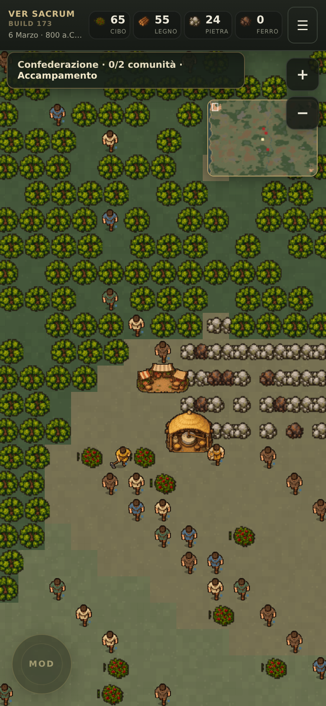
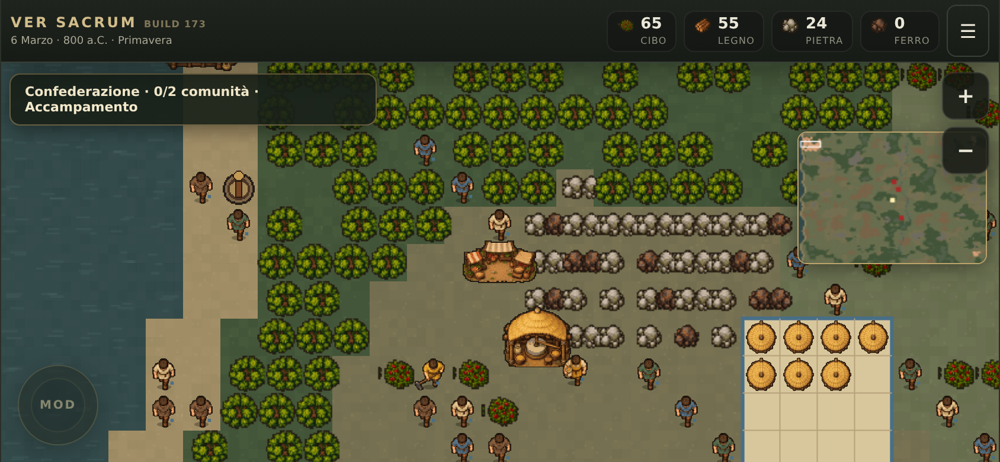

# Ver Sacrum · grafica completa P16

**PROVVISORIO, da approvare da Simone nella partita sul Redmi Note 10.**

Il campione di `docs/campione-grafica/` ha dato la direzione visiva. Le cinque tavole nuove in `sorgenti/` sono originali di lavoro: edifici, persone, artigiani, animali e risorse. I PNG del gioco sono ritagli e riduzioni veri con alpha 0/255, non semplici maschere visive sulla tavola. `tools/grafica-completa-genera.py` li rigenera e `tools/grafica-completa-verifica.py` controlla dimensioni, margini, varianti e cache offline.

## Come appare sul telefono

[Il foglio dei 79 asset](controllo-atlanti.png) permette di confrontare i ritagli alla stessa scala. [La prima visita](prima-visita-telefono.png) mostra ancora la scelta del luogo e non crea un salvataggio prima della scelta.

La scena affollata è una prova sintetica di leggibilità e prestazioni: 55 persone sono state aggiunte solo nel browser di test, non alla partita reale.

## Collegamento al gioco

| Famiglia | Dove appare | Stato |
|---|---|---|
| 13 edifici | `asset-render.js` per totem, falegnameria, forno, mercato, recinto, magazzino, torre e botteghe; `village-footprint.js` per le casette | PNG nuovi. Il magazzino malformato è sostituito da un PNG decodificabile. |
| 14 mestieri + 3 tuniche del libero | `asset-render.js`; mestiere dalla mansione effettiva, colore di fazione in un piccolo segno accanto alla persona | PNG nuovi; le quattro mansioni artigiane hanno figure dedicate. Variante del libero stabile per ID. |
| 4 animali × 3 stati | `asset-render.js` | PNG nuovi vivo, abbattuto, scheletro; PNG pecora e lupo di ripiego nello stesso stile. |
| Risorse naturali | `asset-render.js` | 30 varianti usate, più fascio di tronchi preparato per l’UI; i boschi e le bacche pieni/medi hanno tre orientamenti. |
| Terreno, campi, palizzate | `p16-render.js`, `agriculture.js`, `construction-placement.js` | Disegno procedurale conservato per strade, stagioni, crescita, angoli e incroci; palette e contrasti uniformati alla scena approvata. |
| UI | `app.css` e `asset-render.js` | Quattro icone risorsa e indicatore di selezione P16 nuovi. Menu e testi HTML restano leggibili e accessibili. |

Il vecchio materiale SVG/PNG non più usato resta nel repository come riferimento storico. Il service worker precarica i nuovi PNG richiesti dal gioco, senza il vecchio gruppo SVG dei mestieri, animali e risorse. Se un asset non arriva, il renderer mantiene il disegno procedurale di ripiego. I file sorgente delle tavole non entrano nella cache offline.

## Verifiche richieste

1. `python3 tools/grafica-completa-verifica.py`: 79 PNG attivi con margini e alpha validi; totale circa 169 KiB.
2. `nice -n 15 node --test tests/*.cjs`: **471/471 test passati**, fail 0; risultato nel registro di ricerca.
3. Browser locale soltanto su `127.0.0.1`, poi spento: portrait e landscape Redmi simulati, zero errori JavaScript o file mancanti; con 69 persone totali p95 frame 36,8 ms verticale e 23,6 ms orizzontale. Prima visita: una navigazione, scelta iniziale visibile, nessun salvataggio precoce, cache offline con 134 voci.
4. Il test fisico sul Redmi e il giudizio finale della grafica spettano a Simone. Il salvataggio non cambia formato.

Limite visivo: la riduzione a 42×42 pixel comprime molti dettagli delle tavole sorgente; nel mondo i mestieri si leggono soprattutto per abito, attrezzo e sagoma. Gli scheletri hanno ossa stilizzate e piccoli dettagli diversi per specie; restano una convenzione visiva. Non attribuiamo abiti, insegne o armature a una popolazione storica specifica senza prova.
